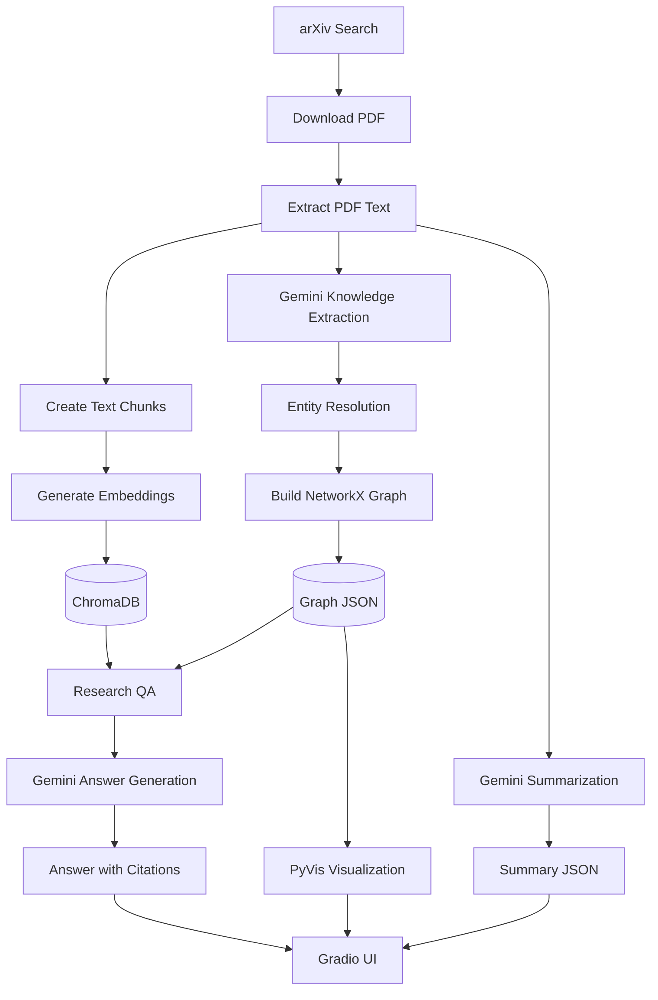
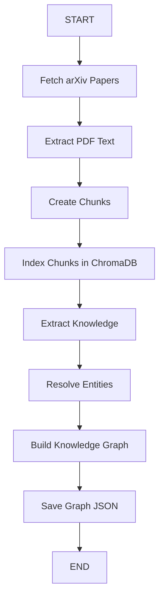
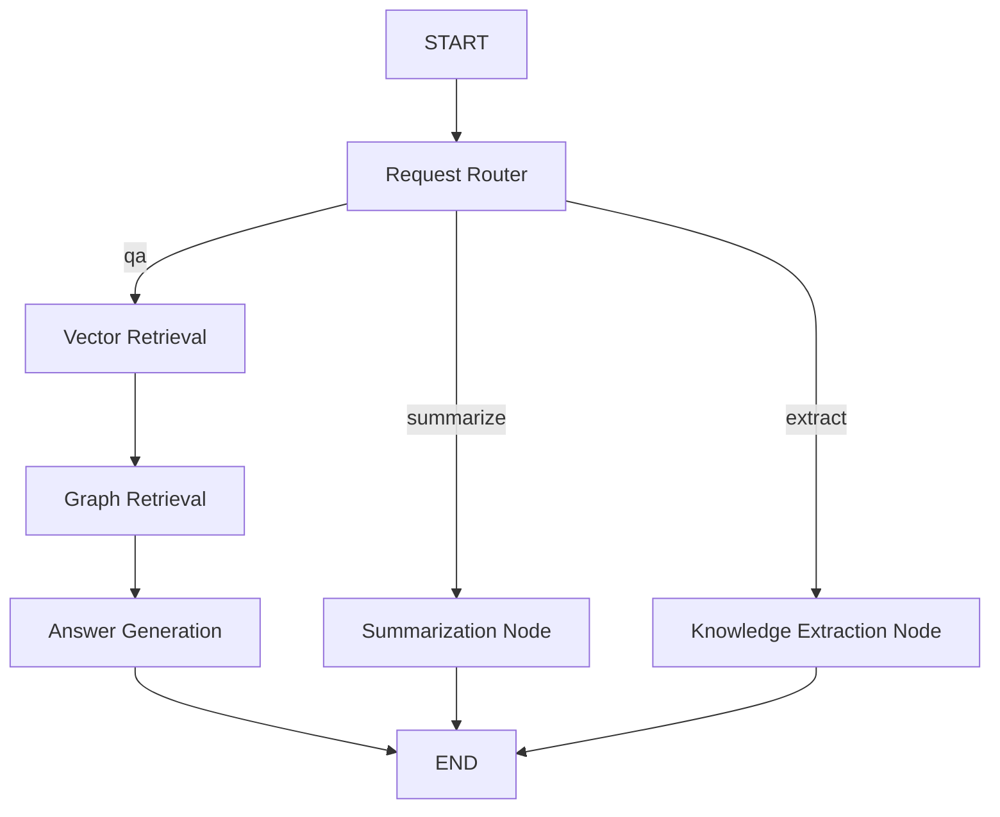

# Autonomous Research Paper Summarization & Knowledge Graph Builder
## 1. Project Overview
The **Autonomous Research Paper Summarization & Knowledge Graph Builder** is an AI-powered application that ingests scientific research papers, extracts structured knowledge, builds knowledge graphs, and answers questions using Retrieval-Augmented Generation (RAG).

The application combines vector-based retrieval, knowledge graph traversal, Large Language Models (LLMs), and LangGraph workflow orchestration to help researchers explore scientific papers more efficiently.

Users can select an ingested paper from a Gradio interface and perform three main tasks:

- **Question Answering:** Ask questions about a paper and receive answers grounded in relevant passages and knowledge graph relationships.

- **Paper Summarization:** Generate a structured summary covering the objective, methodology, datasets, key findings, contributions, and limitations.

- **Knowledge Extraction:** Extract research methods, datasets, metrics, concepts, findings, and relationships into structured JSON.

The application also generates an interactive knowledge graph that visualizes the entities and relationships identified in a research paper.

## 2. Key Features
- **arXiv Integration:** Search for scientific papers and download their PDFs.

- **PDF Processing:** Extract text from downloaded research papers.

- **Text Chunking:** Split paper text into overlapping chunks for semantic retrieval.

- **Semantic Search:** Generate embeddings using Sentence Transformers and store them in ChromaDB.

- **Structured Knowledge Extraction:** Use Gemini to identify research entities and relationships.

- **Entity Resolution:** Use RapidFuzz to identify and merge similar entity names.

- **Knowledge Graph Construction:** Represent papers, entities, and relationships using NetworkX.

- **Graph Visualization:** Generate interactive HTML visualizations using PyVis.

- **Research Paper Summarization:** Generate structured summaries using Gemini.

- **Graph-Enhanced RAG:** Combine vector retrieval and knowledge graph context to answer questions.

- **Workflow Orchestration:** Use LangGraph to route requests and coordinate processing steps.

- **Interactive UI:** Use Gradio to access Q&A, summarization, knowledge extraction, and graph visualization.

## 3. Technology Stack
| Technology | Purpose |
|---|---|
| Python 3.11+ | Application development |
| uv | Dependency and project management |
| arXiv Python library | Search and download research papers |
| PyMuPDF | Extract text from PDFs |
| LangChain Text Splitters | Split extracted text into chunks |
| Sentence Transformers | Generate semantic embeddings |
| ChromaDB | Persist and retrieve paper chunks |
| Google Gemini | Summarization, knowledge extraction, and answer generation |
| Pydantic | Validate structured knowledge extraction output |
| RapidFuzz | Match and resolve duplicate entities |
| NetworkX | Construct and query knowledge graphs |
| PyVis | Generate interactive knowledge graph visualizations |
| LangGraph | Orchestrate research workflows |
| Gradio | Provide the interactive user interface |

## 4. High-Level Architecture
The application has two major workflows: paper ingestion and research interaction.



### Architecture explanation
1. The ingestion workflow downloads research papers and extracts their text.

2. The extracted text is divided into chunks and embedded for semantic retrieval.

3. Chunks and metadata are stored in ChromaDB.

4. Gemini extracts structured entities and relationships from the paper.

5. Entity resolution reduces duplicate entities before the graph is constructed.

6. NetworkX stores the resulting knowledge graph, which is persisted as JSON.

7. The QA workflow retrieves relevant text and graph relationships.

8. Gemini uses the retrieved context to generate a grounded answer.

9. Summarization and knowledge extraction provide separate outputs.

10. Gradio exposes these capabilities through a single interface.

## 5. Project Directory Structure
The following structure describes the main modules and data directories used by the application.

```text

research-paper-knowledge-graph/

│

├── scripts/

│   ├── test_arxiv.py

│   ├── test_pdf_processor.py

│   ├── test_chunker.py

│   ├── test_vector_store.py

│   ├── test_knowledge_extractor.py

│   ├── test_entity_resolver.py

│   ├── test_entity_matching.py

│   ├── test_graph_store.py

│   ├── test_graph_connectivity.py

│   ├── test_summarizer.py

│   ├── test_qa_agent.py

│   ├── test_research_graph.py

│   ├── test_ingestion_graph.py

│   ├── test_dynamic_graph.py

│   └── test_filtered_search.py

│

├── src/

│   └── research_assistant/

│       ├── __init__.py

│       ├── models.py

│       │

│       ├── ingestion/

│       │   ├── __init__.py

│       │   ├── arxiv_client.py

│       │   └── pdf_processor.py

│       │

│       ├── processing/

│       │   ├── __init__.py

│       │   ├── chunker.py

│       │   ├── embeddings.py

│       │   └── entity_resolver.py

│       │

│       ├── storage/

│       │   ├── __init__.py

│       │   ├── vector_store.py

│       │   └── graph_store.py

│       │

│       ├── agents/

│       │   ├── __init__.py

│       │   ├── knowledge_extractor.py

│       │   ├── summarizer.py

│       │   └── qa_agent.py

│       │

│       ├── workflows/

│       │   ├── __init__.py

│       │   ├── research_graph.py

│       │   └── ingestion_graph.py

│       │

│       └── ui/

│           ├── __init__.py

│           ├── app.py

│           └── graph_visualizer.py

│

├── data/

│   ├── papers/

│   ├── processed/

│   ├── chunks/

│   ├── chroma_db/

│   └── graph/

│

├── .env

├── .gitignore

├── pyproject.toml

├── uv.lock

└── README.md

```

**Note:** The test-script list reflects scripts created during development. If a script is not present in your current repository, create it before running it.

### Directory responsibilities
| Directory | Responsibility |
|---|---|
| `ingestion/` | Search arXiv, download PDFs, and extract text |
| `processing/` | Chunk text, generate embeddings, and resolve entities |
| `storage/` | Persist vector data and knowledge graphs |
| `agents/` | Implement summarization, knowledge extraction, and Q&A |
| `workflows/` | Orchestrate ingestion and research tasks using LangGraph |
| `ui/` | Provide the Gradio interface and graph visualization |
| `scripts/` | Test individual modules and complete workflows |
| `data/papers/` | Store downloaded PDFs |
| `data/processed/` | Store extracted text, metadata, summaries, and extracted knowledge |
| `data/chunks/` | Store generated chunk records |
| `data/chroma_db/` | Store the persistent ChromaDB collection |
| `data/graph/` | Store graph JSON files and generated HTML visualizations |

## 6. Module-by-Module Explanation
### 6.1 `ingestion/arxiv_client.py`
**Purpose:** Search arXiv and download research papers.

Main function:

- `fetch_papers(query, max_results)`

Responsibilities:

1. Search arXiv using a query such as `cat:cs.LG`.

2. Retrieve paper metadata, including title, authors, publication date, categories, and PDF URL.

3. Download each PDF to `data/papers/`.

4. Save metadata to `data/processed/papers.json`.

Example:

```python

from research_assistant.ingestion.arxiv_client import fetch_papers

papers = fetch_papers(

    query="cat:cs.LG",

    max_results=1,

)

print(papers)

```

The returned paper records contain the paper ID and local PDF path required by subsequent processing steps.

### 6.2 `ingestion/pdf_processor.py`
**Purpose:** Extract readable text from a downloaded PDF.

Main functions:

- `extract_text(pdf_path)`

- `save_extracted_text(pdf_path)`

Responsibilities:

1. Open the PDF using PyMuPDF.

2. Extract text page by page.

3. Preserve page numbers.

4. Combine the extracted pages into `full_text`.

5. Save the result as `data/processed/\<paper_id>.json`.

The saved JSON contains:

- `paper_id`

- `pdf_path`

- `total_pages`

- `pages`

- `full_text`

This structured output is consumed by the chunker, summarizer, and knowledge extractor.

### 6.3 `processing/chunker.py`
**Purpose:** Divide extracted paper text into manageable chunks.

Main function:

- `chunk_paper(json_path)`

The current splitter uses:

- Chunk size: 1,000 characters

- Chunk overlap: 200 characters

The overlap preserves context across adjacent chunks and helps reduce information loss at chunk boundaries.

Each chunk contains:

- `paper_id`

- `chunk_id`

- `chunk_index`

- `text`

Chunk records are saved to `data/chunks/\<paper_id>_chunks.json`.

### 6.4 `processing/embeddings.py`
**Purpose:** Convert text into numerical vectors for semantic search.

The `EmbeddingGenerator` uses the Sentence Transformers model:

`sentence-transformers/all-MiniLM-L6-v2`

The model produces 384-dimensional embeddings.

These embeddings allow ChromaDB to retrieve semantically related passages even when the question and paper text do not use exactly the same words.

### 6.5 `storage/vector_store.py`
**Purpose:** Persist text chunks and retrieve relevant passages.

The `VectorStore` class uses a persistent ChromaDB collection named `research_papers`.

Main methods:

- `add_chunks(chunks)` — generate embeddings and upsert chunks with metadata.

- `search(query, top_k=3, paper_id=None)` — retrieve the most relevant chunks.

Each stored record includes `paper_id` and `chunk_index` metadata.

The optional `paper_id` parameter restricts retrieval to a selected paper:

```python

results = store.search(

    query="What datasets are used in LIBERO-PeRM?",

    top_k=3,

    paper_id="2610.22372v1",

)

```

Without a paper ID, the search can retrieve chunks across the collection. The QA workflow should pass the selected paper ID to keep the answer grounded in the intended paper.

### 6.6 `models.py`
**Purpose:** Define validated data structures for extracted research knowledge.

The main Pydantic models are:

- `ResearchEntity` — represents an entity, its type, and description.

- `ResearchRelationship` — represents a source entity, relationship, and target entity.

- `ResearchExtraction` — groups the extracted entity categories and relationships.

Entity types include methods, datasets, metrics, concepts, and findings.

These models provide a structured contract between Gemini knowledge extraction and downstream entity resolution and graph construction.

### 6.7 `agents/knowledge_extractor.py`
**Purpose:** Extract structured research knowledge from paper text.

Main functions:

- `create_llm()` — configure the Gemini client using environment variables.

- `extract_knowledge(paper_text)` — extract entities and relationships using structured output.

The extractor asks Gemini to identify:

- Research methods

- Datasets

- Evaluation metrics

- Concepts

- Key findings

- Relationships between entities

The output is validated against the `ResearchExtraction` Pydantic model.

The extraction result is subsequently used by the entity resolver and graph store.

### 6.8 `processing/entity_resolver.py`
**Purpose:** Identify duplicate or near-duplicate entity names.

Main function:

- `resolve_entities(entities, similarity_threshold=90)`

The resolver:

1. Groups entities by type.

2. Normalizes entity names.

3. Compares names using RapidFuzz.

4. Uses string similarity and token-set similarity to identify potential duplicates.

5. Returns canonical entities and an alias mapping.

For example, `GeoState` and `Geostate` may be resolved to a common canonical name.

Entity resolution improves graph quality by reducing duplicate nodes. Some relationships may still be skipped when their endpoints cannot be resolved unambiguously.

### 6.9 `storage/graph_store.py`
**Purpose:** Build and persist the research knowledge graph.

The `KnowledgeGraphStore` class uses a NetworkX `MultiDiGraph`.

Main methods:

- `add_paper(paper_id, title)`

- `add_entities(entities, paper_id)`

- `add_relationships(relationships, entities, aliases)`

- `save(filename)`

- `print_summary()`

The graph contains:

- Paper nodes

- Entity nodes

- Paper-to-entity `contains` relationships

- Research relationships extracted from the paper

Node identifiers include the entity type and normalized name. This helps distinguish entities with identical names but different types.

Graphs are saved as JSON files under `data/graph/`, using filenames such as:

`2610.22372v1_graph.json`

### 6.10 `agents/summarizer.py`
**Purpose:** Generate a structured summary of a research paper.

Main functions:

- `summarize_paper(paper)`

- `save_summary(summary)`

Gemini generates six sections:

1. Objective

2. Methodology

3. Datasets

4. Key Findings

5. Contributions

6. Limitations

The summarizer uses the extracted paper text and instructs the model not to invent unsupported findings or limitations.

Summaries are saved to:

`data/processed/\<paper_id>_summary.json`

### 6.11 `agents/qa_agent.py`
**Purpose:** Answer research questions using retrieved text and knowledge graph context.

The `ResearchQAAgent` combines:

- ChromaDB semantic retrieval

- NetworkX graph traversal

- Gemini answer generation

Its graph retrieval logic identifies entities mentioned in the question and collects incoming and outgoing relationships for those nodes.

The retrieved passages and relationships are supplied to Gemini with instructions to answer only from the available evidence and cite textual sources.

A typical citation looks like:

`[Paper ID: 2610.22372v1, Chunk: 26]`

The agent supports loading a graph through its `graph_path` parameter. The workflow should provide the selected paper's graph path when processing a question.

### 6.12 `workflows/ingestion_graph.py`
**Purpose:** Orchestrate end-to-end ingestion using LangGraph.

Current workflow:



The workflow uses three nodes:

- `fetch_node` — searches arXiv and downloads PDFs.

- `process_node` — extracts text, creates chunks, and indexes them.

- `graph_node` — extracts knowledge, resolves entities, and saves a graph for each successfully processed paper.

This workflow connects the existing modules without duplicating their core logic.

### 6.13 `workflows/research_graph.py`
**Purpose:** Route research requests to the appropriate workflow.

The current request router uses deterministic keyword rules to classify requests into:

- `qa`

- `summarize`

- `extract`

The selected request type determines the branch executed by LangGraph.



#### Q&A branch
1. Retrieve relevant paper chunks from ChromaDB.

2. Retrieve related graph relationships from NetworkX.

3. Pass both contexts to Gemini.

4. Return an answer with source citations.

#### Summarization branch
1. Load the processed paper text.

2. Call `summarize_paper()`.

3. Save the structured summary.

4. Return the summary.

#### Knowledge extraction branch
1. Load the processed paper text.

2. Call `extract_knowledge()`.

3. Save structured entities and relationships.

4. Return the extracted knowledge.

The current router is rule-based, not an LLM-based planner. The Gradio task selection supplies a request phrase, and the router uses its keywords to select the branch.

### 6.14 `ui/graph_visualizer.py`
**Purpose:** Convert a saved graph JSON file into an interactive HTML visualization.

Main function:

- `visualize_graph(graph_json, output_html)`

The visualizer:

1. Loads the NetworkX graph from JSON.

2. Creates PyVis nodes and edges.

3. Colors nodes according to entity type.

4. Displays entity descriptions and relationship labels.

5. Saves the interactive graph as HTML.

The visualization is generated under `data/graph/`.

### 6.15 `ui/app.py`
**Purpose:** Provide the user-facing Gradio interface.

The UI currently supports:

- Searching arXiv from the sidebar with a query and maximum-results setting
- Previewing selected results with title, paper ID, publication date, and an abstract excerpt
- Ingesting a selected paper through the LangGraph ingestion workflow
- Refreshing the ingested-paper dropdown after ingestion
- Selecting a paper shared across the Research Assistant, Knowledge Graph, and Evaluation Dashboard tabs
- Asking questions, generating paper summaries, and extracting structured research knowledge
- Displaying source information for Q&A results
- Viewing and downloading the interactive knowledge graph
- Displaying retrieval, graph-structure, and entity-extraction evaluation results when the required data is available
- Showing live elapsed-time feedback while Q&A, summarization, or knowledge extraction runs

Paper choices for analysis are built from local processed-paper and graph files. Titles are loaded from `data/processed/papers.json`, with fallback logic using the paper node in the saved graph or the paper ID.

The UI invokes `research_graph` to execute research tasks and uses `visualize_graph()` to generate graph HTML. The arXiv discovery UI uses `search_arxiv()`, and selected papers are processed through `ingest_selected_paper()`.

Dynamic arXiv search, paper preview, and ingestion from the Gradio UI are implemented.

## 7. Environment Configuration
Create a `.env` file in the project root:

```dotenv

GOOGLE_API_KEY=your_google_api_key

GEMINI_MODEL=gemini-2.5-flash

```

Use a valid Google AI API key and the Gemini model configured for your environment.

**Security guidelines:**

- Never commit `.env` to Git.

- Ensure `.env` is listed in `.gitignore`.

- Do not print API keys in logs.

- Do not place API keys directly in Python source files.

## 8. Installation and Setup
### Prerequisites
- Python 3.11 or later

- uv installed

- Internet access for arXiv downloads and Gemini requests

- A valid Google API key

### Step 1: Navigate to the project
```bash

cd research-paper-knowledge-graph

```

### Step 2: Install dependencies
```bash

uv sync

```

If setting up the project before the dependencies have been added, the main dependencies include:

```bash

uv add arxiv pymupdf langchain-text-splitters sentence-transformers chromadb langchain-google-genai python-dotenv rapidfuzz networkx pyvis langgraph gradio

```

Use the existing `pyproject.toml` and `uv.lock` as the source of truth for your installed dependency versions.

### Step 3: Configure the API key
Create the `.env` file described in Section 7.

### Step 4: Verify the environment
```bash

uv run python --version

```

Confirm that the project runs under Python 3.11 or later.

## 9. Running the Application
### 9.1 Launch the Gradio UI
From the project root:

```bash

uv run python -m research_assistant.ui.app

```

Open the local URL printed by Gradio, typically:

`http\://127.0.0.1:7860`

### 9.2 Use the application
1. In **Discover Papers**, enter a topic or arXiv query and choose the maximum number of results.
2. Click **Search Papers** and select a result to preview its title, paper ID, publication date, and abstract excerpt.
3. Click **Ingest Selected Paper** and wait for the ingestion status.
4. Select the paper from **Ingested Papers** in the sidebar. The selected paper is shared across all three tabs.
5. In **Research Assistant**, select **Ask a question**, **Summarize paper**, or **Extract knowledge**.
6. Enter a question for Q&A, then click **Run**. The status area displays elapsed time while the task runs.
7. Review the answer and sources, the structured summary, or the extracted-knowledge tables.
8. Open **Knowledge Graph** to inspect or download the graph, and **Evaluation Dashboard** to review available metrics.

Newly ingested papers are added to the local data directories and become available for analysis after successful ingestion.

### 9.3 Run the ingestion workflow
To download and process a new paper through the LangGraph ingestion workflow, use:

```bash

uv run python scripts/test_ingestion_graph.py

```

The test script currently requests a small number of papers using its configured arXiv query.

After ingestion, the processed paper should have:

- A downloaded PDF

- Extracted text JSON

- Chunk JSON

- ChromaDB records

- A knowledge extraction JSON

- A knowledge graph JSON

## 10. Testing and Validation
The project includes scripts for testing individual modules and end-to-end workflows.

Run the scripts from the project root using `uv run python`.

### 10.1 Individual module tests
| Script | What it validates | Command |
|---|---|---|
| `test_arxiv.py` | arXiv search and PDF download | `uv run python scripts/test_arxiv.py` |
| `test_pdf_processor.py` | PDF text extraction | `uv run python scripts/test_pdf_processor.py` |
| `test_chunker.py` | Text chunking | `uv run python scripts/test_chunker.py` |
| `test_vector_store.py` | Embedding storage and semantic retrieval | `uv run python scripts/test_vector_store.py` |
| `test_knowledge_extractor.py` | Structured Gemini extraction | `uv run python scripts/test_knowledge_extractor.py` |
| `test_entity_resolver.py` | Entity deduplication | `uv run python scripts/test_entity_resolver.py` |
| `test_entity_matching.py` | Entity name matching and aliases | `uv run python scripts/test_entity_matching.py` |
| `test_graph_store.py` | Graph construction and persistence | `uv run python scripts/test_graph_store.py` |
| `test_graph_connectivity.py` | Graph connectivity checks | `uv run python scripts/test_graph_connectivity.py` |
| `test_summarizer.py` | Summary generation and saving | `uv run python scripts/test_summarizer.py` |
| `test_qa_agent.py` | Standalone QA retrieval and generation | `uv run python scripts/test_qa_agent.py` |

### 10.2 Workflow tests
**Test LangGraph routing and execution**

```bash

uv run python scripts/test_research_graph.py

```

Validates the QA, summarization, and extraction branches according to the requests configured in the script.

**Test end-to-end ingestion**

```bash

uv run python scripts/test_ingestion_graph.py

```

Validates paper download, text extraction, chunk creation, vector indexing, knowledge extraction, and graph construction.

**Test dynamic graph loading**

```bash

uv run python scripts/test_dynamic_graph.py

```

Validates that the QA agent can load a graph using a specified paper ID and retrieve its relationships.

**Test paper-specific vector retrieval**

```bash

uv run python scripts/test_filtered_search.py

```

Validates that ChromaDB returns chunks belonging to the requested paper ID.

### 10.3 Testing notes
- Scripts that call arXiv require internet access.

- Scripts that call Gemini require a valid API key and may incur API usage.

- The ingestion workflow writes files and modifies the persistent vector database.

- Run ingestion tests with a small `max_results` value to limit processing time and API usage.

- The test scripts described here are standalone scripts; run only those present in your repository.

- If a module's interface changes, update the corresponding test script.

## 11. Data Artifacts
The main output files are:

| Artifact | Location |
|---|---|
| Downloaded PDFs | `data/papers/` |
| arXiv metadata | `data/processed/papers.json` |
| Extracted paper text | `data/processed/\<paper_id>.json` |
| Chunk records | `data/chunks/\<paper_id>_chunks.json` |
| Vector database | `data/chroma_db/` |
| Knowledge extraction | `data/processed/\<paper_id>_extraction.json` |
| Paper summary | `data/processed/\<paper_id>_summary.json` |
| Knowledge graph | `data/graph/\<paper_id>_graph.json` |
| Interactive graph HTML | `data/graph/\<paper_id>_graph.html` |

The vector database is persistent. Re-running ingestion should use the same chunk IDs to upsert existing chunks instead of creating duplicate records.

## 12. Current Implementation Status
| Capability | Status |
|---|---|
| arXiv paper ingestion | Implemented |
| PDF text extraction | Implemented |
| Chunking and embeddings | Implemented |
| ChromaDB semantic retrieval | Implemented |
| Paper-specific retrieval | Implemented |
| Structured knowledge extraction | Implemented |
| Entity resolution | Implemented |
| NetworkX knowledge graph construction | Implemented |
| PyVis visualization | Implemented |
| Gemini summarization | Implemented |
| Graph-enhanced RAG Q&A | Implemented |
| LangGraph conditional request routing | Implemented |
| LangGraph ingestion workflow | Implemented |
| Gradio UI | Implemented |
| Embedded knowledge graph | Implemented |
| Dynamic arXiv search and result preview in the UI | Implemented |
| Ingestion of a selected search result from the UI | Implemented |
| Live elapsed-time status for research tasks | Implemented |
| Retrieval evaluation using labelled chunk IDs | Implemented for configured queries |
| Graph-structure evaluation | Implemented |
| Entity-extraction evaluation against ground truth | Implemented for one configured paper per current ground-truth file |
| Summary token-overlap evaluator | Implemented as a function; not connected to the dashboard |
| Q&A faithfulness, relevance, and correctness evaluation | Not yet implemented in the dashboard |
| Multi-paper ground-truth aggregation | Planned |

## 13. Known Limitations
- The request router uses keyword rules and may need improvement when users phrase requests differently.

- Entity resolution can merge similar names incorrectly or leave ambiguous relationships unresolved.

- Graph retrieval currently uses entity-name matching and neighboring relationships; it is not a full graph-reasoning engine.

- The quality of answers depends on retrieval quality and the evidence contained in the selected paper.

- Retrieval and entity-extraction metrics depend on manually reviewed ground-truth labels. The current evaluation loaders support one configured paper ID per ground-truth file; multi-paper aggregation remains to be implemented.
- Entity extraction uses exact normalized-name matching, so valid synonyms or alternate naming conventions may be counted as mismatches.
- Graph-structure metrics describe topology and do not establish factual accuracy or completeness.
- Summary token-overlap evaluation exists as a standalone function but is not connected to the dashboard. Token overlap does not fully measure factual correctness or semantic quality.
- Q&A faithfulness, answer relevance, and correctness are not yet integrated into the evaluation dashboard.
- The current workflow uses the configured Gemini model for generation and requires an external API connection.
- Paper titles may fall back to paper IDs when metadata is unavailable.
- Graphs can become crowded as the number of extracted entities and relationships increases.

## 14. Future Enhancements
Potential next steps include:

1. Extend independently reviewed entity and retrieval ground-truth datasets to cover 5–10 papers.
2. Update evaluation loaders and the dashboard to aggregate metrics across multiple papers and queries.
3. Connect summary evaluation to the UI and consider stronger semantic and factual evaluation methods after mentor feedback.
4. Add Q&A evaluation for faithfulness, answer relevance, and correctness.
5. Improve request classification and workflow error handling.
6. Improve graph retrieval using entity relevance and relationship filtering.
7. Improve entity resolution and relationship validation.
8. Add automated tests for workflow branches, invalid inputs, and failure scenarios.
9. Improve graph layouts, filtering, and search within the UI.
10. Improve summary citations and provenance tracking, and continue refining logging and execution-status reporting.

- **Evaluation Framework:** Evaluate the system across five dimensions:

  - **Entity Extraction Accuracy:** Measure how accurately entities and relationships are extracted from research papers.

  - **Graph Connectivity:** Assess the connectivity and completeness of the generated knowledge graph.

  - **Retrieval Relevance:** Evaluate whether the retrieved paper chunks and graph relationships are relevant to the user's query.

  - **Summary Quality:** Assess the accuracy, completeness, and relevance of generated paper summaries.

  - **Q&A Performance:** Evaluate answer correctness, relevance, and factual grounding against the source papers.

## Evaluation Metrics and Ground Truth

The current evaluation framework includes the following measurements:

- **Retrieval relevance:** Precision@K and Recall@K are calculated for questions with labelled relevant chunk IDs in `data/processed/retrieval_ground_truth.json`. The current UI matches the question text exactly (case-insensitively) and requires labels for the selected paper.
- **Entity extraction:** Precision, recall, and F1 are calculated by comparing extracted entity names against `data/processed/evaluation_ground_truth.json` using case-folded, whitespace-normalized exact matching.
- **Knowledge graph structure:** Node count, edge count, connected components, largest-component ratio, isolated nodes, and graph density describe graph structure; these measures do not establish factual accuracy.
- **Summary lexical overlap:** `evaluation/summary_evaluator.py` provides token-overlap precision, recall, and F1 against a reference summary. This function is not currently connected to the dashboard.

The current ground-truth loaders are configured for one paper ID per JSON file. Expanding ground truth to multiple independently reviewed papers and aggregating the results is planned work. Verify entity lists, relevant chunk IDs, and reference summaries against source papers independently; labels derived from system output can make evaluation misleading.

## 15. End-to-End Workflow Summary
The project transforms a scientific paper into multiple useful research artifacts:

**Research paper → Extracted text → Text chunks → Embeddings and vector index → Structured knowledge → Entity resolution → Knowledge graph → Q&A, summarization, and visualization**

The result is an interactive research assistant that combines semantic retrieval, explicit knowledge relationships, and LLM-based generation to help users explore scientific literature.
